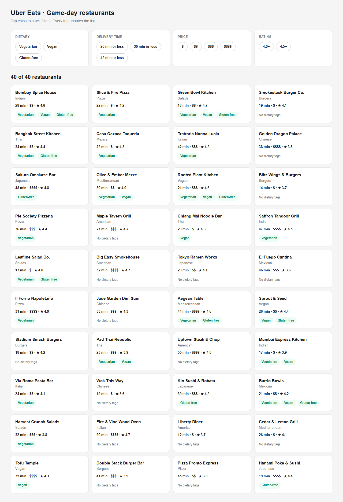

# Uber Eats · Game-day stackable restaurant filters

A Next.js (App Router) + TypeScript page that renders the 40-restaurant Game-Day set as cards. This is the typed foundation for the stackable filters (delivery time, price, dietary, rating).



## Checks
- [Expected-results check table](checks/expected-results.md): four hand-worked filter stacks with names and counts, used to judge the filter code.

## Data
- `data/restaurants.csv` is the Uber Eats Game-Day Restaurant Set, committed as-is and read from the project folder at build time (`lib/restaurants.ts`). Nothing is hand-typed or fetched from the web.
- Every row is validated while loading: unknown price tiers or non true/false flags fail the build instead of rendering bad data.

## Types (`lib/types.ts`)
- `Restaurant`: one typed row. `priceBand` is `PriceBand = "$" | "$$" | "$$$" | "$$$$"`, mapped from `price_tier` 1-4, never a plain string.
- `FilterState`: four groups (`delivery`, `price`, `dietary`, `rating`), each `null` when nothing is picked. Multi-pick groups use `NonEmptyList<T>`, so an empty list cannot compile; `toGroup()` turns an emptied chip list back into `null`. `EMPTY_FILTERS` is the starting state.
- Strict TypeScript, with no type-check escape hatches anywhere in the project.

## Rule calls to note
- Vegan counts as vegetarian in the filter: three rows (Chiang Mai Noodle Bar, Sprout & Seed, Tofu Temple) are vegan but flagged not vegetarian. The data file is left untouched; this is a filter rule, and cards still show only the tags the data says yes to.
- Delivery limits and rating minimums are inclusive, and the chip names say so: the delivery chips read "20 / 30 / 45 min or less" (not "Under 30"), so Olive & Ember Mezze at exactly 30 min matches what the label promises; exactly 4.0 passes 4.0+.
- Cards with no dietary flags (16 of 40, e.g. Smokestack Burger Co., Liberty Diner) show a "No dietary tags" line, so the slot reads as deliberate rather than broken.

## Run
```bash
npm install
npm run dev   # http://localhost:3000
```
